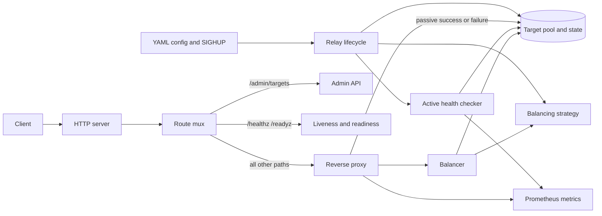

# Relay

Relay is a compact, health-aware HTTP load balancer written in Go. It routes traffic across backend targets, stops routing to unhealthy targets, retries safe requests, enforces per-IP and concurrency limits, exposes Prometheus metrics, and reloads routing configuration on `SIGHUP`.

[Quick Start](#quick-start) | [Architecture](docs/architecture.md) | [Usage and Configuration](docs/usage.md) | [Testing](#testing) | [Benchmarks](docs/benchmarks.md)

> **Status:** Active development. The current build covers the full single-node HTTP load balancer path, including health management, five balancing strategies, live reload, observability, and graceful shutdown.

## Why I Built Relay

I wanted to work on the parts of backend infrastructure that are easy to hide behind a framework: connection reuse, request retries, health state, lock ownership, graceful shutdown, configuration reloads, and observability.

Relay is deliberately small enough to reason about and complete enough to run end to end. The goal was not to clone NGINX or Envoy. The goal was to understand the failure modes behind them and make explicit engineering choices.

The project explores:

- Reverse proxy behavior and HTTP connection reuse
- Concurrent access to shared routing and health state
- Load balancing algorithms and their operational differences
- Active and passive failure detection
- Safe retry boundaries and idempotency
- Graceful shutdown and live configuration reload
- Metrics, structured logs, and operational endpoints

## What Relay Does

- Routes HTTP traffic to a configured set of backend targets
- Supports `round_robin`, `weighted_round_robin`, `least_conn`, `least_response_time`, and `consistent_hash`
- Runs active TCP or HTTP health checks
- Tracks passive failures and recovers targets after successful requests when active health checks are disabled
- Retries `GET` and `HEAD` requests on connection failures
- Enforces per-IP token-bucket rate limits and a global max-in-flight limit
- Reloads targets, weights, strategy, health settings, limits, and retry settings on `SIGHUP`
- Exposes Prometheus metrics and structured JSON or text logs
- Provides `/admin/targets`, `/healthz`, and `/readyz`
- Handles `SIGINT` and `SIGTERM` with graceful server shutdown

## Architecture at a Glance



A request follows this path:

1. The HTTP server accepts the request.
2. The route mux sends operational paths to their handlers and everything else to the proxy.
3. The proxy applies rate and concurrency limits.
4. The balancer selects a healthy target with the configured strategy.
5. The reverse proxy forwards the request and records the result.
6. Success or failure updates target state and Prometheus metrics.

The full component design is in [docs/architecture.md](docs/architecture.md).

## Quick Start

### Docker Compose

The example stack starts three backends, Relay, and Prometheus.

```bash
docker compose -f examples/docker-compose.yml up --build
```

Then open:

- Relay: `http://localhost:8080`
- Admin target state: `http://localhost:8080/admin/targets`
- Relay metrics: `http://localhost:9090/metrics`
- Prometheus: `http://localhost:9091`

Switch strategies without changing the backends:

```bash
RELAY_CONFIG=/configs/wrr.yml docker compose -f examples/docker-compose.yml up -d relay
```

Available strategy configs are in `examples/strategies/`.

### Local Development

Start backends in separate terminals:

```bash
go run ./examples/backends -port 9001 -id api_1
go run ./examples/backends -port 9002 -id api_2
```

Build and run Relay:

```bash
make build
./bin/relay -config relay.yml
```

Or run it directly:

```bash
go run ./cmd/relay -config relay.yml
```

Test the proxy:

```bash
curl http://localhost:8080/
curl http://localhost:8080/admin/targets
curl http://localhost:8080/readyz
```

The repository config uses port `8080`, two local targets, TCP health checks, Prometheus metrics on `:9090`, and error-level logging. See [docs/usage.md](docs/usage.md) for the full configuration reference.

## Engineering Problems and Solutions

These are the main problems that shaped the implementation.

| Problem | Solution | Why It Matters |
| --- | --- | --- |
| With active health checks disabled, all targets started unhealthy, so Relay returned `503` and routed no traffic. | Startup marks all targets healthy when active checks are off. Passive tracking then marks targets unhealthy after consecutive failures and recovers them on success. | Disabling active probes must not stop traffic. |
| Consistent hashing could move keys when target order changed. | The ring uses sorted target IDs and 128 virtual nodes per target. | Stable key-to-target mapping is the point of consistent hashing. |
| Retries could duplicate unsafe requests or repeatedly hit the same target. | Retries are limited to `GET` and `HEAD`. The balancer excludes attempted targets when alternatives exist. | Side-effect safety matters more than retrying every failure. |
| Health results could arrive after a target address changed. | Health updates include the checked address. The pool rejects the update when the address no longer matches. | A stale probe must not mark a new backend unhealthy. |
| Reloading health settings could race with in-flight checks. | The old checker is canceled and awaited before the pool and checker are rebuilt. | Reload must leave one consistent health state. |
| Shutdown could return while health probes were still running. | Shutdown cancels the lifecycle context, stops and waits for health work, then drains both servers. | The process must not mutate state after shutdown completes. |
| Reload and shutdown could race on configuration state. | One lifecycle mutex serializes health startup, reload, and shutdown. | Shared lifecycle state needs a single ownership boundary. |
| Reload reset limits and retry settings that did not change. | Limits and retries update only when their values change. A changed limit replaces only the affected component. | Avoid dropping token buckets or in-flight accounting without cause. |
| YAML spelling mistakes were silently ignored. | The loader uses strict field checking, defaults, and explicit validation. | Bad config should fail at startup, not at 3 a.m. |
| `retry_attempts: 0` could not disable retries because zero was treated as “unset.” | The field is a pointer. `nil` means default, and `0` means disabled. | Configuration must distinguish absence from an explicit zero. |
| Creating metrics twice panicked on duplicate registration. | Registration reuses an existing collector when Prometheus reports a duplicate. | Tests and embedded use should not panic on repeated construction. |
| One failed server shutdown skipped cleanup of the other server. | Shutdown attempts both servers, closes idle connections, and joins errors. | Cleanup must continue after a partial failure. |
| A zero health timestamp rendered as year 1 in the admin API. | The admin response uses an empty string for an unset timestamp. | Operational APIs should not expose meaningless values. |

## Decisions and Tradeoffs

| Decision | Tradeoff | Reason |
| --- | --- | --- |
| Single process with in-memory state | No persistence, clustering, or shared health state | Keeps the data model small and the failure modes understandable |
| Active probes plus passive failure tracking | Extra probe traffic and more state transitions | Active checks detect failures early. Passive checks catch failures between intervals. |
| CRC32-based consistent hashing | Less uniform than newer hash families | Standard library only, fast, and adequate for this scope |
| 128 virtual nodes per target | More ring memory and rebuild work | Better key distribution without making the ring expensive |
| EWMA with `alpha = 0.2` for least response time | Smoother latency signal, but slower reaction to sudden changes | Reduces noisy routing decisions from single slow requests |
| Per-IP token buckets | Memory growth with many client IPs | Simple rate limiting with periodic idle-bucket cleanup |
| Retry only `GET` and `HEAD` | No automatic retry for `POST`, `PUT`, or other writes | Avoids duplicate side effects |
| Retry only transport failures | No retry for HTTP 5xx responses | A valid backend response is not necessarily safe to replay |
| SIGHUP config reload | Listener and logging changes still need a restart | Keeps reload deterministic and avoids draining live listeners |
| Internal Go packages | No public embedding API yet | Frees the code to evolve before committing to API stability |
| Unauthenticated admin endpoints | The deployment must protect them at the network layer | Keeps the single-node operational surface small |
| No TLS termination | Deploy behind an external TLS proxy when needed | Relay stays focused on HTTP load balancing |
| Plain HTTP upstreams | No upstream TLS support yet | Matches the current HTTP-only scope |

## Configuration Reload

Send `SIGHUP` to reload the active config file:

```bash
kill -HUP "$(pgrep -f './bin/relay')"
```

These changes apply without a restart:

- Targets, addresses, and weights
- Balancing strategy
- Health check settings
- `max_inflight`
- `rate_limit_rps`
- `retry_attempts`

These changes require a restart:

- Server address and HTTP timeouts
- Shutdown timeout
- Metrics enablement and address
- Logging level and format

Relay logs a warning when a restart-only field changes. See [docs/usage.md](docs/usage.md#configuration-reload) for details.

## Observability

### Endpoints

| Endpoint | Purpose |
| --- | --- |
| `/admin/targets` | Current target list, health, failures, and last check time |
| `/healthz` | Process liveness |
| `/readyz` | Readiness. Returns `503` when no healthy targets exist. |
| Metrics listener | Prometheus metrics on the configured address |

### Metrics

| Metric | Type | Description |
| --- | --- | --- |
| `relay_requests_total` | Counter | Total requests handled by Relay |
| `relay_request_errors_total` | Counter | Failed or rejected requests |
| `relay_healthy_targets` | Gauge | Current healthy target count |
| `relay_target_requests_total` | Counter vector | Requests per target and status code |
| `relay_request_duration_seconds` | Histogram | End-to-end request duration |

Logs use `log/slog` and include a component field. Use JSON format when shipping logs to an aggregator.

## Testing

```bash
make test
make test-race
make lint
```

The test suite covers:

- Unit tests for strategies, target state, config loading, and validation
- Proxy tests for routing, retries, limits, request IDs, and failure handling
- Health checker tests for TCP and HTTP probes, transitions, and cancellation
- Relay lifecycle tests for reload, health changes, shutdown, and target ordering
- A chaos test that kills a backend while requests are in flight

## Performance

On a Ryzen 5 5600H laptop, with all services and k6 on the same host, Relay held 5600 requests per second with p50 `0.22 ms`, p95 `0.35 ms`, and p99 `0.68 ms`, with zero errors. Direct-to-backend traffic at the same rate measured p50 `0.11 ms` and p99 `0.26 ms`. Relay held 8000 requests per second with p99 `0.93 ms` and no dropped iterations; at 12000 offered requests per second it dropped load and p99 rose to `6.92 ms`.

The full setup, per-strategy results, saturation steps, and Go microbenchmarks are in [docs/benchmarks.md](docs/benchmarks.md). Reproduce with `make bench`.

## Project Layout

```text
cmd/relay/          CLI entry point and signal handling
internal/config/    YAML loading, defaults, and validation
internal/relay/     Lifecycle, routing, admin endpoints, reload, shutdown
internal/proxy/     Reverse proxy, retries, rate limiting, request IDs
internal/balancer/  Target selection and strategy orchestration
internal/strategy/  Round robin, weighted, least connections, LRT, consistent hash
internal/target/    Target pool, health state, passive failure tracking
internal/health/    Active TCP and HTTP health checker
internal/metrics/   Prometheus collectors
internal/logging/   Structured logger construction
docs/               Architecture and usage documentation
examples/           Backends, strategy configs, Docker Compose, load tests
```

## Roadmap

- Add a stable public Go package API
- Add upstream TLS and configurable transport settings
- Add request tracing and richer latency metrics
- Add admin authentication and safer operational defaults
- Add dynamic service discovery
- Add TCP and gRPC transports
- Expand benchmarks to multi-host and CI runs

## Documentation

- [Architecture](docs/architecture.md)
- [Usage and Configuration](docs/usage.md)
- [Benchmarks](docs/benchmarks.md)
- [Example configs](examples/config)
- [Strategy examples](examples/strategies)

## License

MIT
