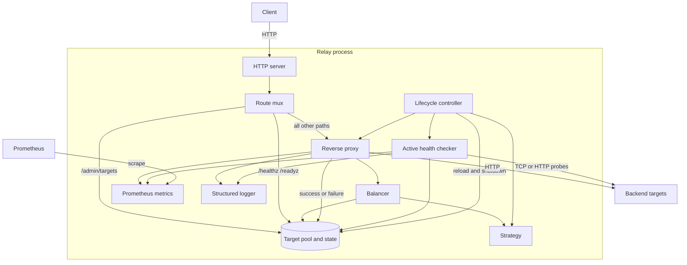
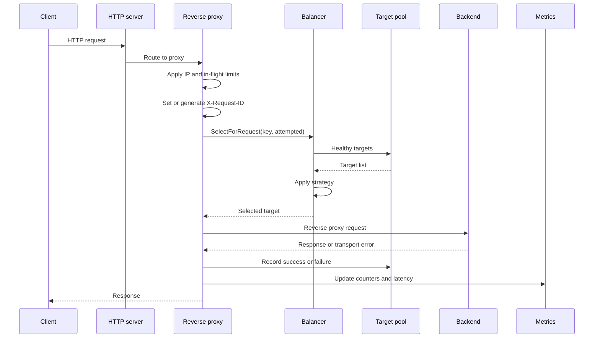
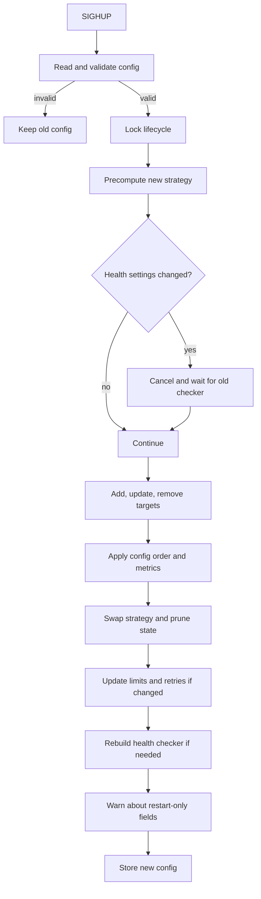

# Relay Architecture

This document explains how Relay works as a system. It covers the main components, the request and lifecycle paths, the concurrency model, and the failure behavior.

## Purpose and Scope

Relay is a single-node HTTP load balancer. It owns four responsibilities:

1. Accept HTTP traffic.
2. Select a healthy backend target.
3. Forward the request and record the result.
4. Keep target, health, and configuration state consistent.

It does not provide clustering, service discovery, TLS termination, or persistent state. Those boundaries are deliberate. They keep the system small enough to reason about while preserving the operational problems that make a load balancer interesting.

## System Context

## Startup Path

The CLI starts Relay in this order:

1. `cmd/relay` parses `-config`.
2. `config.Load` reads the YAML file.
3. The loader applies defaults and validation.
4. `relay.New` builds the target pool, strategy, balancer, proxy, HTTP server, and metrics server.
5. `Relay.Start` starts the health checker and metrics listener, then blocks on the main HTTP server.

Targets start as unhealthy. If active health checks are enabled, the checker marks them healthy after the first successful probe. If active checks are disabled, startup marks every target healthy and enables passive failure tracking.

## Request Path

### 1. HTTP server

The main HTTP server uses configured read, write, idle, and header timeouts. The route mux reserves three operational paths and sends every other path to the proxy.

### 2. Proxy guards

The proxy applies two independent controls before target selection:

- A per-IP token bucket rejects excess requests with `429`. The key is the direct peer IP, not `X-Forwarded-For`.
- A global buffered channel limits concurrent in-flight requests and rejects overflow with `429`.

The proxy also creates or preserves `X-Request-ID`. This value is used for request logs and as the consistent-hash key when present. When it is absent, the client IP becomes the key.

### 3. Target selection

The balancer asks the target pool for healthy targets. It then applies the active strategy.

For retries, the balancer receives a set of targets already attempted. It filters those targets out when at least one alternative remains. If every healthy target was attempted, it can fall back to the full healthy set.

### 4. Forwarding

Relay creates a request-scoped `httputil.ReverseProxy` for each attempt. The shared transport provides connection pooling and upstream timeouts.

The response writer captures the final status code. It also implements `Unwrap`, which lets standard HTTP helpers reach the original writer.

### 5. Result handling

The proxy records one of three outcomes:

- Transport failure: report a target failure.
- HTTP `5xx`: report a target failure and pass the backend response through.
- Other status codes: report a target success.

The current retry policy applies only to `GET` and `HEAD` requests and only to transport failures. Relay does not retry `5xx` responses.

## Components

### Configuration

`internal/config` owns parsing, defaults, and validation. The loader uses strict YAML field checking. Unknown fields, duplicate target IDs, invalid addresses, invalid ports, invalid strategies, invalid log settings, and negative numeric settings fail before the relay starts.

The retry setting is a pointer internally. A missing value uses the default of `1`. An explicit `0` disables retries.

### Relay lifecycle

`internal/relay` owns assembly and lifecycle:

- Build the target pool and mark startup health.
- Build the strategy and balancer.
- Build the proxy, metrics, HTTP server, and metrics server.
- Start health checks and listeners.
- Serialize reload and shutdown with `lifecycleMu`.
- Apply live configuration changes.
- Drain both servers on shutdown.

### Target pool

`internal/target` stores:

- Target metadata in a map.
- Per-target state in a parallel map.
- A target order slice for deterministic iteration.
- A passive recovery flag.

Each target state contains health, consecutive failure count, and last check time.

The pool uses an `RWMutex`. Reads include `List`, `Healthy`, `HealthyCount`, `Get`, and `GetState`. Writes include `Add`, `Update`, `Remove`, `SetHealthy`, `SetHealthyForAddress`, `Reorder`, and the passive failure methods.

Address changes reset target health and failure state. Health updates also carry the probed address. The pool rejects the update when the address changed after the probe started.

### Balancer

`internal/balancer` separates target selection from strategy implementation.

The balancer holds the current strategy behind an `RWMutex`. It supports optional strategy capabilities through small interfaces:

- `SelectWithKey` for consistent hashing.
- `Inc` and `Done` for in-flight tracking.
- `Observe` for response-time tracking.
- `Prune` for removing state for deleted targets.

This keeps the base `Strategy` interface small. Strategies opt into only the behavior they need.

### Strategies

| Strategy | Selection behavior | Uses target weight |
| --- | --- | --- |
| `round_robin` | Rotates through healthy targets | No |
| `weighted_round_robin` | Smooth weighted rotation | Yes |
| `least_conn` | Chooses the target with the fewest in-flight requests | No |
| `least_response_time` | Chooses the lowest EWMA response time | No |
| `consistent_hash` | Hashes a key onto a 128-virtual-node ring | No |

Consistent hashing sorts target IDs before building the ring. This makes the ring independent of config order. Known targets with no latency sample are rotated first by least-response-time.

### Health checker

`internal/health` runs active probes.

- One pass starts immediately, then repeats on the configured interval.
- Each pass checks at most 10 targets concurrently.
- TCP mode tests a connection to the target address.
- HTTP mode sends a `GET` to the configured path and accepts `2xx`.
- Redirects are not followed.
- All probes honor the lifecycle context, so shutdown and health reload can cancel them.

The checker applies a result only if the target ID and address still match the probed target. This prevents a stale probe from changing the state of a replacement backend.

Passive failure tracking complements active probes:

- Each transport failure or `5xx` increments the failure count.
- Three consecutive failures mark a target unhealthy.
- A success resets the failure count.
- When active checks are disabled, a success also marks the target healthy.

When active checks are enabled, the active checker is the authority for recovery.

### Metrics and logging

`internal/metrics` registers Prometheus collectors and tolerates repeated construction by reusing an existing collector on duplicate registration.

`internal/logging` wraps `log/slog` and adds component fields such as `relay`, `proxy`, and `health`. Text and JSON output are supported.

## Configuration Reload

Reload starts when the CLI receives `SIGHUP`.

The reload path is ordered to protect consistency:

1. Load and validate before taking the lifecycle lock.
2. Precompute the strategy before mutating target state.
3. Stop and wait for health work before rebuilding health state.
4. Diff targets and restore config order.
5. Apply strategy and state pruning.
6. Update only changed limit and retry settings.
7. Rebuild and start health checks when health settings changed.
8. Store the new config and log restart-only changes.

A failed load or validation leaves the old configuration active.

## Shutdown

Shutdown starts on `SIGINT` or `SIGTERM`. The CLI creates a timeout context from `shutdown_timeout`.

The shutdown path:

1. Take the lifecycle lock.
2. Mark the relay as stopped.
3. Cancel the root context.
4. Stop and wait for the health checker.
5. Shut down the main HTTP server.
6. Shut down the metrics server when enabled.
7. Close idle upstream connections.
8. Join server errors and return.

Each server shutdown call receives a context derived from the caller context and the configured shutdown timeout. Relay attempts both servers even when the first shutdown fails.

If the main HTTP listener fails during startup, the CLI calls shutdown before it returns the startup error. This cleans up health checks, the metrics listener, and idle connections.

## Concurrency and State Ownership

| Component | Protection | Owns |
| --- | --- | --- |
| Relay lifecycle | `lifecycleMu` | Start, reload, shutdown, stored config, health context |
| Target pool | `sync.RWMutex` | Targets, per-target state, order, passive recovery flag |
| Balancer | `sync.RWMutex` | Strategy pointer and metrics pointer |
| Strategies | Per-strategy mutexes and atomics | Cursor, weights, in-flight counters, latency samples, hash ring |
| Proxy limits | `sync.RWMutex` | Rate limiter, in-flight channel, retry count |
| Health checker | `WaitGroup` and context | Probe loop lifetime |
| Metrics | Prometheus collectors | Counters, gauges, histograms |
| Logger | `log/slog` | Structured output |

Design rules:

- Configuration is immutable after load. The relay stores a copy.
- Reload and shutdown never run at the same time.
- Request handlers snapshot proxy limit state under a read lock.
- Target and balancer locks are held for short state operations, not for network I/O.
- Health probes run outside pool locks. The pool lock is taken only to read state and apply a result.
- Strategies own their internal state and must be safe for concurrent selection.

## Failure Behavior

| Condition | Behavior |
| --- | --- |
| No healthy targets | `503 Service Unavailable` |
| Target connection failure | Retry on `GET` or `HEAD` when attempts remain. Return `502` on the final attempt. |
| Target timeout | Retry on `GET` or `HEAD` when attempts remain. Return `504` on the final attempt. |
| Backend returns `5xx` | Mark the target failure and return the backend response. Do not retry. |
| Rate limit exceeded | `429 Too Many Requests` |
| In-flight limit exceeded | `429 Too Many Requests` |
| Active probe fails | Mark the target unhealthy |
| Three passive failures | Mark the target unhealthy |
| Metrics listener fails | Log the error. The data plane keeps running. |
| Invalid startup config | Exit with an error |
| Invalid reload config | Log the error and keep the old config |
| Shutdown timeout | Return the joined shutdown error and exit non-zero |

## Extension Points

- **New strategy:** implement `strategy.Strategy`. Add optional interfaces for keyed selection, in-flight tracking, latency observation, or pruning when needed.
- **New health probe:** extend the checker mode dispatch and validation.
- **New transport:** add a listener and protocol handler beside the HTTP server.
- **New metrics:** add collectors in `internal/metrics` and update them at the relevant lifecycle or request point.
- **Dynamic discovery:** add a discovery component that calls pool update methods, then reuses the reload and health consistency rules.

## Design Boundaries

Relay is not designed for these cases yet:

- Multi-node coordination or shared health state
- Persistent target state
- Automatic service discovery
- TLS termination or mutual TLS
- Authenticated admin endpoints
- Weighted least-connections or weighted consistent hashing
- Retrying non-idempotent methods

These boundaries keep the current implementation honest. They also define the next set of engineering problems.
